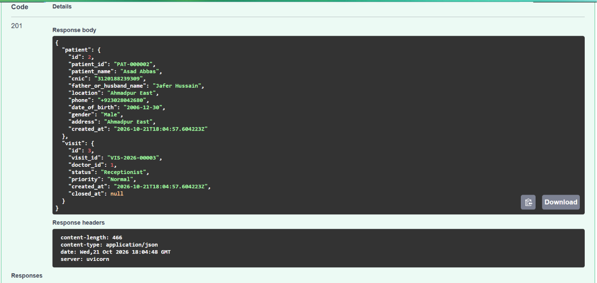
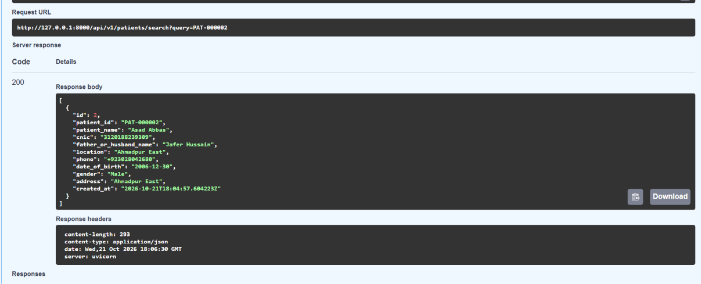
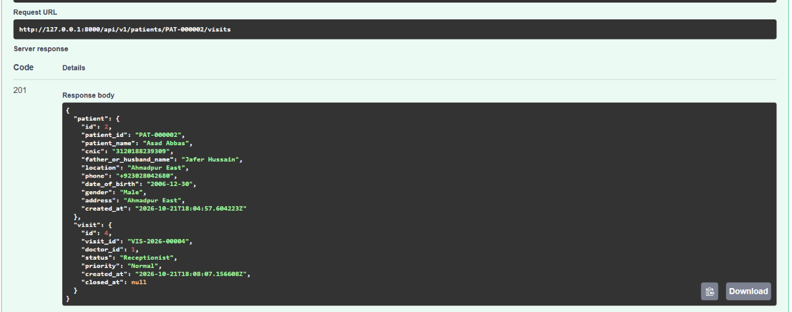

# Milestone 3: Patient Registration and Visit Management

**Status:** Completed and manually tested

**Technology:** FastAPI, SQLAlchemy, PostgreSQL, Neon

## Implemented features

- Patient registration with unique Patient IDs.
- Automatic creation of the first visit during registration.
- Patient search using Patient ID, CNIC, or phone.
- Duplicate CNIC and phone prevention.
- Creation of additional visits for existing patients.
- Doctor assignment and Normal/Emergency visit priority.
- Database transactions to keep patient and visit creation consistent.
- Verification of persisted records in Neon PostgreSQL.

## Evidence

Screenshots of the successful API responses and the corresponding PostgreSQL records are stored separately.
### Register New Patient

### Search Existing Patient

### Creating visit using Patient Id

## Next milestone

Implement secure authentication, session management, and role-based access control before expanding the system to additional hospital workflows.